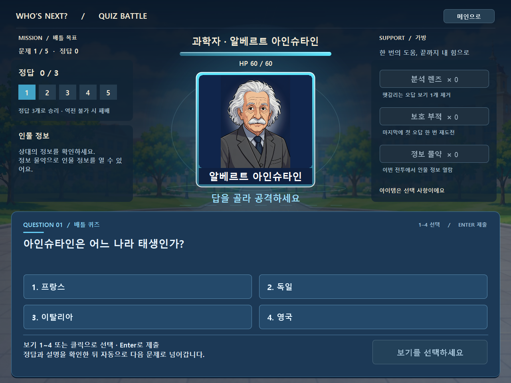
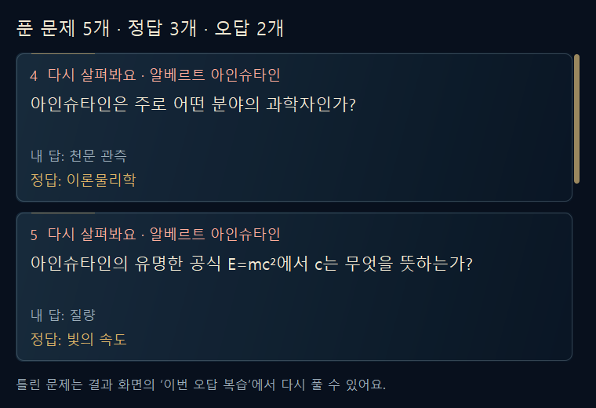
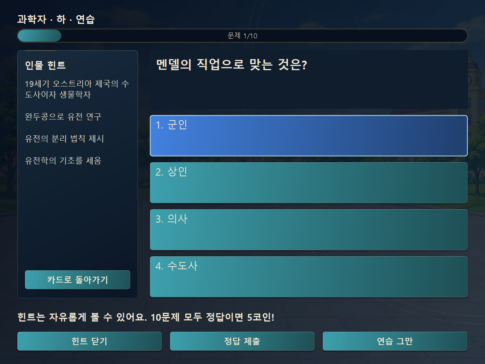

# WHO’S NEXT? — 8분 발표안

**발표의 중심: “문제를 푸는 재미를 만들고, 결과가 복습으로 이어지도록 구현했습니다.”**

전체 클래스 구조 대신 **① 학습형 전투 ② 오답 복습 ③ 흐름을 유지하는 UI** 세 가지만 깊게 설명한다. 먼저 동작을 보여주고, 그 동작을 만든 코드 5~8줄을 설명한다. 코드 전체를 읽지 않는다.

## 1. 시간 배분 — 7분 30초 발표 + 30초 여유

| 시간 | 보여줄 것 | 핵심 메시지 |
|---|---|---|
| 0:00–0:40 | 제목·메인 화면 | 인물 상식을 가볍게 익히고 싶은 학생을 위한 퀴즈 어드벤처 |
| 0:40–1:20 | 지도 → 도감 → 도전 준비 | 퀴즈를 카드 수집과 마을 진행에 연결해 다음 목표 제공 |
| 1:20–3:20 | 전투 정답·HP·마무리 영상 + 코드 | 문제 풀이를 전투 행동으로 표현하되 학습 기회 유지 |
| 3:20–5:10 | 결과 → 학습 기록 → 이번 오답 복습 + 코드 | 점수 확인에서 끝내지 않고 틀린 문제를 다시 풀도록 연결 |
| 5:10–6:40 | 답 선택 → 힌트 열고 닫기 + 코드, 정답/오답 연출 | 사용자 선택을 유지하고 행동의 결과를 명확하게 전달 |
| 6:40–7:10 | 검증 결과 한 장 | 보상·기록·화면 연결도 테스트로 확인 |
| 7:10–7:30 | 마무리 | 재미·학습·사용 편의가 연결된 게임 |
| 7:30–8:00 | 전환 지연 대비 | 새 기능 설명을 추가하지 않는 여유 시간 |

게임 한 판 전체를 현장에서 풀면 시간을 넘기기 쉽다. **전투와 연출은 짧게 녹화하고, 힌트 전환과 복습은 클릭 시연**하는 구성을 권장한다. 슬라이드는 7장 정도로 제한한다.

## 2. 핵심 ① 정답을 전투 행동으로 표현 — 기획 + 기능성



**시연:** 정답 선택 → HP 감소·공격 효과 → 이후 문제 진행 → 마지막 승패 연출을 20~30초 영상으로 보여준다. PPT에는 위 화면에서 **문제 / HP / 진행 상태** 세 곳만 강조한다.

**설명할 이유:** 단순한 정오 표시를 공격과 수집 보상으로 바꿔 다음 문제를 풀 동기를 만들었다. 다만 정답 3개를 맞혔다고 즉시 종료하면 남은 문제를 보지 않게 되므로, 승리 가능성이 있는 동안 5문제를 진행한다. 승리가 불가능해지면 불필요한 진행을 끝낸다.

실제 코드 발췌 — [`BattleEngine.advance()`](../src/main/java/org/kgu/game/feature/BattleEngine.java) (일부 분기 생략):

```java
int remaining = QUESTION_COUNT - turn;
boolean retryPossible = firstWrong >= 0 && (itemUsed == ShopItem.SHIELD
        || (itemUsed == null && shieldInInventory && remaining > 0));
if (correctCount + remaining + (retryPossible ? 1 : 0) < REQUIRED_CORRECT) {
    phase = Phase.FINISHED;
} else if (turn < QUESTION_COUNT) {
    phase = Phase.QUESTION;
}
```

**코드 설명:** “현재 정답 수에 남은 문제와 가능한 재도전을 더해서, 승리 기준 3개에 도달할 수 있는지 판단합니다.” 예를 들어 보호 부적을 쓸 수 없는 상태에서 3문제를 모두 틀리면, 남은 2문제를 맞혀도 3개가 되지 않아 종료한다. 반대로 처음 3개를 맞히면 승리 조건을 충족한 상태로 남은 2문제도 푼다.

**발표 대사:**
> “일반 도전과 보스 모두 선택한 인물의 5문제를 풉니다. 정답은 상대 HP 감소와 공격 연출로 표현됩니다. 승리만 빨리 얻고 끝내기보다 남은 문제도 학습하도록 했고, 더 이상 역전할 수 없을 때는 종료하도록 구현했습니다. 아이템도 강공격 대신 보기 제거·정보 열람·오답 재도전처럼 문제 풀이를 돕는 역할로 구성했습니다.”

기술 설명은 **판정은 `BattleEngine`, 연출은 `BattlePanel`과 효과 클래스가 담당한다**는 한 문장으로 마친다. 분야별 효과는 기존 통합 기능이며 이번 수정에서 모두 새로 만든 것처럼 소개하지 않는다.

## 3. 핵심 ② 결과를 복습으로 연결 — 기능성



**시연:** 오답이 있는 판의 결과 → 학습 기록 → 내 답과 정답 확인 → 결과로 돌아가 ‘이번 오답 복습’ 클릭. 위 예시는 **5문제 중 정답 3개·오답 2개인 테스트 데이터**를 렌더링한 화면이다. 실제 사용자 학습 성과를 측정한 자료는 아니다.

**설명할 이유:** 정답 수만 보여주면 무엇을 틀렸는지 잊기 쉽다. 제출한 답안을 저장해 내 답과 정답을 비교하고, 이번 판에서 틀린 문제만 바로 다시 풀 수 있도록 했다. 학습 기록에는 오답을 먼저 배치한다.

실제 코드 발췌 — [`GameSession.wrongEntries()`](../src/main/java/org/kgu/game/feature/GameSession.java):

```java
public List<QuestionBank.Entry> wrongEntries() {
    return answers.stream()
        .filter(answer -> !answer.correct())
        .map(AnswerRecord::entry).toList();
}
```

**코드 설명:** 모든 문제를 처음부터 다시 내는 대신, 실제 제출 기록에서 오답만 추출한다. 이후 `GameFeature.startCurrentReview()`가 완료된 판의 보상을 저장하고 이 문제들로 새 복습 세션을 만든다. **오답이 2개라면 2개만 재출제**된다. 보호 부적의 재도전은 최초 답안 기록을 덮어쓰지 않아 실제로 틀렸던 문제도 확인할 수 있다.

**발표 대사:**
> “결과 화면에서 보상만 받고 끝나지 않도록 했습니다. 사용자가 선택했던 답과 정답을 함께 보여주고, 바로 이번 오답만 다시 풀 수 있습니다. 별도의 메뉴에서 문제를 찾아야 하는 과정을 줄였고, 제출 기록을 기준으로 복습 대상을 만들었습니다.”

여기서는 ‘학습 효과가 입증됐다’가 아니라 **‘복습을 쉽게 시작하도록 구현했다’**고 표현한다.

## 4. 핵심 ③ 문제 풀이의 흐름을 유지하는 UI — UI



**시연:** 연습에서 보기 하나 선택 → 힌트 열기 → 카드로 돌아가기. **선택한 보기와 문제가 유지되는 것**을 보여준다. 이어 정답 카드의 반짝임·이동과 오답 카드의 찢어짐·사라짐을 10초 내외 영상으로 보여준다.

**설명할 이유:** 힌트를 별도 창으로 열면 문제 화면을 가리거나 창 사이를 이동해야 한다. 왼쪽 카드 영역만 힌트로 전환해서 오른쪽 문제·보기는 계속 확인하도록 했다. 도전 준비와 규칙·아이템 안내에도 내부 화면 전환을 적용했다.

실제 코드 발췌 — [`QuestionView`](../src/main/java/org/kgu/game/view/QuestionView.java) (관련 문장만 발췌):

```java
portraitPages.add(practiceCard, "portrait");
portraitPages.add(hintContent, "hint");
// 힌트 열기
portraitLayout.show(portraitPages, "hint");
// 카드로 돌아가기
portraitLayout.show(portraitPages, "portrait");
```

**코드 설명:** `CardLayout`에 카드와 힌트를 겹쳐 등록하고 보이는 패널만 바꾼다. 문제와 답안 선택 상태를 새로 만들지 않기 때문에, 힌트를 닫아도 진행을 이어갈 수 있다. 애니메이션은 별도로 Swing 타이머와 Java2D로 그리며, 정답 카드는 제자리로 복귀하고 오답 카드는 사라진 뒤 다음 문제에서 새 카드가 표시된다.

**발표 대사:**
> “색상이나 장식뿐 아니라 사용자가 문제를 푸는 흐름을 유지하는 데 집중했습니다. 힌트를 열어도 문제와 선택한 답은 그대로 보입니다. 정답과 오답은 카드 움직임으로 구분하고, 화면 이동 뒤에도 선택이 유지되도록 개선했습니다.”

## 5. 시작·마무리에 넣을 내용만 추리기

**시작 40초:**
> “WHO’S NEXT?는 인물 상식을 가볍게 익히고 싶은 학생을 위한 퀴즈 어드벤처입니다. 과학자·아이돌·한국사·교수님을 분야별 마을로 구성했습니다. 퀴즈를 풀어 카드를 모으고 다음 도전에 진입하며, 틀린 문제는 결과에서 바로 복습하도록 했습니다. 오늘은 이 연결을 만드는 세 가지 기능을 실제 화면과 코드로 보여드리겠습니다.”

**규모는 한 줄만:** 4분야·80명·3난이도·1,200문제·240단계 카드. 콘텐츠 양 자체보다 이 데이터를 플레이·수집·복습에 공통으로 사용하는 점을 강조한다.

**검증 30초:** JUnit **83개**, 통합 검사 **1,944개** 통과. 숫자만 읽지 말고 “연습 만점 5코인 중복 지급 방지, 힌트를 닫은 뒤 선택 유지, 이번 판 오답만 복습하는 흐름을 확인했다”고 설명한다. 자동 검사가 실제 사용자 만족도나 학습 성과를 증명하는 것은 아니다.

**마무리 20초:**
> “퀴즈를 전투와 수집의 재미로 표현하고, 결과를 복습으로 연결했습니다. 또한 내부 화면 전환과 명확한 피드백으로 문제 풀이 흐름이 끊기지 않도록 구현했습니다. 앞으로는 실제 사용자 피드백을 받아 문제 품질과 보상 균형을 개선하고자 합니다.”

## 6. 발표 직전 준비

- `feat/final` 실행, 로그인 ID `cheat` 또는 `admin`. 마을·교수님 도전과 도감 미리보기만 열리며 무한 코인·아이템·자동 정답은 아니다.
- 전투 영상과 오답이 있는 결과를 미리 준비한다. 아이템 사용 장면은 실제 재고를 확보해 녹화한다.
- 위 PNG는 실제 Swing 화면을 테스트로 렌더링한 예시다. PPT에 사용할 수 있으며, 움직임은 녹화 영상으로 보여준다. 전체 코드 화면 대신 발췌 코드와 해당 UI를 한 장에 배치한다.
- 클래스 전체 구조·모든 아이템 가격·모든 보상 수식·실행 명령은 본 발표에서 제외하고 질의응답 자료로 둔다.
- **발표자료와 YouTube 영상 링크를 OTP 사이트에 수업 시작 전 등록**한다. 영상 링크 재생 여부와 오프라인 백업을 확인한다.

실행법·치트 세부 규칙·전체 기능표·제출 체크리스트는 [운영 및 참고 문서](FINAL_RUN_GUIDE.md)에 보관했다.
