# WHO’S NEXT? — 객체지향프로그래밍 최종 발표

화면별 MVP를 하나의 게임으로 통합하고, 변경에 대응하는 객체 구조로 발전시킨 과정.

## 01. 프로젝트 소개와 기획 중점

졸업을 앞둔 학생이 인물 퀴즈와 도전을 통해 실종된 교수님을 구출하는 Java Swing 싱글 플레이 게임이다.

- 문제 풀이를 인물 도전·카드 수집·지원 카드 장착·보스 도전으로 연결했다.
- 연습은 문제를 익히는 공간으로, 배틀은 카드를 얻고 다음 목표에 도전하는 공간으로 구분했다.
- 화면과 기능이 바뀌어도 판정·저장 규칙을 유지할 수 있도록 책임을 나눴다.

차별화 포인트는 인물별 3단계 카드, 지원 능력, 단계별 보스 전투, 구출 대화와 엔딩이다. 발표는 기능 소개와 함께 이 기능들을 어떤 객체에 맡겼는지 설명한다.

사진: 필수 없음. 대표 배틀 화면은 11페이지에 배치한다.

## 02. MVP에서 최종 구조까지

| 단계 | 당시 상황 | 팀의 대응 |
|---|---|---|
| MVP 통합 | 팀원별 구현을 하나의 프로젝트로 연결해야 했다 | 문제·배틀·결과·도감 등 View 단위로 설계·분업했다 |
| 구조 개선 | GUI와 기능이 바뀔 가능성이 있었고 공통 작업 기준이 필요했다 | `feat/new-architecture`에 예시를 먼저 구현하고 View·Event·Feature와 생성자 주입을 공유했다 |
| 중간 평가 반영 | 기능이 부족하다는 평가를 받았다 | 디자인 시스템을 설계하고 전체 UI, 전투 이펙트, 스토리·최종 목표·다이얼로그를 보강했다 |
| 최종 정리 | 기능과 공용 기반의 위치, 리소스·저장 책임을 명확히 해야 했다 | core/domain 경계, classpath 리소스, F1 시연과 결정 기록을 정리했다 |

화면 수를 늘리는 데서 끝내지 않고, 변경할 때 찾아가야 할 클래스와 재사용할 공통 요소를 함께 정리했다.

사진: 필수 없음. 단계별 변화는 위 표로 설명한다.

## 03. 전체 코드 구조 — core와 domain

도메인 기반 설계로 사용자 기능을 묶었다. 게임을 작동시키는 공통 기반은 `core`, 실제 게임플레이와 사용자 기능은 `domain`에서 관리한다. 독립적인 View·Event·Feature 책임을 구분할 수 있는 기능을 도메인 패키지로 나눴다.

```text
src/main/
├─ java/org/kgu/
│  ├─ Main.java
│  ├─ core/
│  │  ├─ application/  앱 조립, 플레이어 세션, 난이도
│  │  ├─ factory/      문제·저장·설정 로딩과 생성
│  │  ├─ manager/      인물·이미지 관리
│  │  ├─ model/        인물·문제·저장 공통 모델
│  │  ├─ progression/  XP·코인·업적·해금·진행도 저장
│  │  ├─ ui/           디자인 토큰, 공용 페인터·아이콘
│  │  └─ window/       화면 계약·전환·공용 Swing 기반
│  └─ domain/
│     ├─ game/         연습·복습·배틀·결과·보상
│     ├─ adventure/    마을·상점·덱·업적·오답 노트
│     ├─ collection/   카드 도감·상세·획득 표시
│     ├─ story/        프롤로그·구출 대화·엔딩
│     ├─ login/        로컬 ID와 플레이어 연결
│     ├─ menu/         메인·게임 준비
│     ├─ setting/      설정
│     ├─ showcase/     F1 장면 시연
│     └─ battle/       기존 팀 통합 데모의 전투 경로
└─ resources/          문제·카드·배경·대본
```

일반 게임의 전투 규칙은 `domain/game/feature/BattleEngine`에서 찾는다. `domain/battle`은 기존 통합 데모 경로이므로 발표 코드 탐색 시 두 엔진을 구분한다.

근거: [코드 탐색 가이드](../ARCHITECTURE.md), [Application](../../src/main/java/org/kgu/core/application/Application.java).

## 04. View·Event·Feature와 의존성 주입

```text
Main → Application → MainWindow에 화면 등록

View의 사용자 입력
  → Event: 입력 전달·화면 갱신 연결
  → Feature: 기능 흐름·보상 정책
  → Session / Engine: 현재 상태·정답·승패
  → Factory / ProgressStore: 리소스·저장
  → View: 바뀐 상태 표시
```

- View는 표시, Event는 입력 연결, Feature는 기능 흐름을 맡는다.
- 루트 View는 화면을 조합한다. 배치·섹션·컨테이너는 `view/layout`, 반복되는 부품은 해당 화면의 `view/component`에 둔다.
- `Application`이 필요한 객체를 만들고 생성자로 전달한다. DI (의존성 주입)를 사용해 화면과 기능의 연결 지점을 외부에 뒀다.
- `GameFeature`는 직접 창을 바꾸지 않고 주입받은 `Consumer<ViewId>`에 목적지를 전달한다.

중간 검사 전에는 GUI와 기능이 모두 바뀔 수 있었다. 당시 규모에서 MVC (모델·뷰·컨트롤러) 체계를 추가하기보다, 필요한 책임 경계와 주입 구조를 먼저 정했다.

근거: [GameFeature](../../src/main/java/org/kgu/domain/game/feature/GameFeature.java), [QuestionGUIEvent](../../src/main/java/org/kgu/domain/game/event/QuestionGUIEvent.java), [PracticeLayout](../../src/main/java/org/kgu/domain/game/view/layout/PracticeLayout.java).

## 05. 객체지향으로 나눈 상태와 행동

| 고려한 점 | 구현 사례 | 얻은 효과 |
|---|---|---|
| 캡슐화 | `BattleEngine`이 선택·제출·진행 메서드에서 현재 단계를 확인한다 | 잘못된 시점의 입력을 규칙 객체에서 거절한다 |
| 추상화 | `View`가 화면 ID·컴포넌트·기준 크기를 제공한다 | 화면 전환 코드는 개별 화면의 배치를 알 필요가 없다 |
| 다형성 | 로그인·문제·결과를 같은 `View` 계약으로 등록한다 | 서로 다른 화면을 동일한 전환 흐름으로 처리한다 |
| 객체 조합 | `QuestionView`가 연습 배치 또는 `BattlePanel`을 조합한다 | 화면별 구성을 담당 부품으로 나눠 변경한다 |
| 상태와 영속 데이터 구분 | `GameSession`은 한 판, `ProgressStore`는 계정 진행도를 관리한다 | 연습 성적과 실제 성장 기록을 분리한다 |

연습의 콤보는 이번 판의 피드백이다. 누적 최고 콤보나 업적 진행도로 저장하지 않는다. 같은 숫자라도 객체가 맡은 의미에 따라 생명주기를 구분했다.

근거: [GameSession](../../src/main/java/org/kgu/domain/game/feature/GameSession.java), [BattleEngine](../../src/main/java/org/kgu/domain/game/feature/BattleEngine.java), [View](../../src/main/java/org/kgu/core/window/View.java).

## 06. SOLID 원칙을 적용한 지점

| 원칙 | 코드 사례 | 설명 |
|---|---|---|
| SRP (단일 책임 원칙) | `BattleEngine`과 `BattlePanel` | 전투 판정과 시각적 피드백의 변경 이유를 나눴다 |
| OCP (개방-폐쇄 원칙) | `MainWindow.register` | 화면을 추가할 때 등록과 조립을 확장하고 기존 화면 전환 알고리즘을 재사용한다 |
| LSP (리스코프 치환 원칙) | `View` 구현 화면 | 구체 화면이 달라도 ID·컴포넌트·크기를 제공하는 계약을 지켜 같은 전환 경로에 넣는다 |
| ISP (인터페이스 분리 원칙) | `View`와 `LifecycleEvent` | 화면 정보와 진입·이탈 처리를 별도 계약으로 나눴다 |
| DIP (의존성 역전 원칙) | `GameFeature`의 `Consumer<ViewId>` | 기능은 구체적인 창 대신 화면 이동 동작의 추상화에 의존한다 |

생성자 주입은 DI (의존성 주입)의 구현 방식이다. DIP의 사례는 그중에서도 기능이 구체 창을 직접 참조하지 않고 이동 계약을 받는 부분이다.

근거: [MainWindow](../../src/main/java/org/kgu/core/window/MainWindow.java), [LifecycleEvent](../../src/main/java/org/kgu/core/window/LifecycleEvent.java), [GameFeature](../../src/main/java/org/kgu/domain/game/feature/GameFeature.java).

## 07. ADR로 설명하는 설계 결정의 변화

ADR (아키텍처 결정 기록)은 구조를 왜 선택했는지 남기는 문서다. 화면별 구현에서 공통 계약으로, 화면 연출에서 독립된 저장 규칙으로 책임을 구체화했다.

| 기록 | 해결한 문제 | 객체지향 관점 | 현재 상태 |
|---|---|---|---|
| ADR-0001: core/domain 경계 | 공용 기반과 화면 기능이 흩어져 있었다 | 기능 응집도와 책임 경계, 객체 조립 위치를 정했다 | Accepted |
| ADR-0002: F1 시연 격리 | 시연의 답안·보상이 실제 계정에 저장될 수 있었다 | 동일 기능에 별도 세션·저장 객체를 조합한다 | Proposed |
| ADR-0003: classpath 리소스 | 루트와 번들 자산이 중복되고 실행 경로에 의존했다 | 로딩 책임을 공용 기반에 모으고 화면은 논리 키로 조회한다 | Accepted |
| ADR-0004: 카드 소유·NEW 저장 | 카드 소유와 알림이 서로 다른 저장 결과가 될 수 있었다 | 저장 확정을 연출과 분리하고 상태 변경을 저장 계층에 둔다 | Proposed |

초기 View·Event·Feature와 DI 도입은 팀의 개발 과정으로 설명한다. 표의 ADR 번호는 현재 기록의 구분이며 당시 결정 날짜의 순서를 뜻하지 않는다. Proposed는 구현이 있어도 승인 완료로 소개하지 않는다.

근거: [ADR-0001](../adr/0001-core-and-domain-packages.md), [ADR-0002](../adr/0002-isolated-showcase.md), [ADR-0003](../adr/0003-classpath-game-resources.md), [ADR-0004](../adr/0004-card-ownership-and-new-state.md).

## 08. Gradle로 빌드와 리소스 처리 통일

팀원마다 실행·빌드 절차가 달라지는 일을 줄이기 위해 Gradle을 사용했다. Wrapper로 Gradle 버전을 맞추고, Windows는 `.\gradlew.bat`, macOS·Linux는 `./gradlew`로 같은 작업을 실행한다. 이미지·문제·대본은 classpath에서 읽어 실행 폴더 이동과 경로 구분자 차이에 따른 문제를 줄였다.

| 비교 기준 | Gradle을 선택한 이유 |
|---|---|
| 게임 실행·배포 | `application` 플러그인으로 실행 진입점과 배포 작업을 한곳에서 관리한다 |
| 리소스 처리 | `processResources`에 디자인 시스템 이미지 복사를 연결한다 |
| 팀 통합 자료 | 카드 ZIP 해제·실행 폴더 준비를 `Copy` 태스크로 정의한다 |
| 작업 순서 | `JavaExec`·`dependsOn`으로 준비·실행·검증의 의존 관계를 명시한다 |

Maven도 크로스플랫폼 빌드와 리소스 패키징을 지원한다. Maven은 생명주기 단계에 플러그인 목표를 연결한다. 이 프로젝트에서는 별도 준비·실행 작업을 직접 태스크로 조합하는 Gradle 구성이 맞았다. Maven의 기능 부족이 아니라 현재 작업 구성에 따른 선택이다.

Gradle만으로 이식성이 보장되지는 않는다. 호환 JDK와 한글 폰트, 대소문자가 일치하는 리소스 경로도 확인해야 한다.

근거: [build.gradle](../../build.gradle), [Gradle Wrapper](https://docs.gradle.org/current/userguide/gradle_wrapper.html), [Application 플러그인](https://docs.gradle.org/current/userguide/application_plugin.html), [태스크 의존 관계](https://docs.gradle.org/current/userguide/task_basics.html), [Maven 생명주기](https://maven.apache.org/guides/introduction/introduction-to-the-lifecycle.html).

## 09. 데이터와 전체 화면 흐름

과학자·한국사·아이돌·교수님 4개 분야의 인물 80명, 인물별 하·중·상 각 5문제인 총 1,200문제, 인물별 3단계 카드 240장을 사용한다.

| 데이터 | 위치·담당 | 사용처 |
|---|---|---|
| 인물·문제 | `resources/questions`, `CategoryFileFactory` | 출제·힌트·전투 상대 |
| 카드·배경·대본 | `resources/images`, `resources/org/kgu` | 도감·문제·스토리 화면 |
| 한 판의 상태 | `GameSession`, `BattleEngine` | 현재 문제·선택·콤보·승패 |
| 계정 저장 | `SaveFactory`, `ProgressStore`, `saves/` | 카드 소유·NEW·성장·오답·해금 |
| 설정 | `SettingFactory`, `settings.properties` | 음향 등 사용자 설정 |

```text
프롤로그 → 로컬 ID 입력 → 최초 튜토리얼 → 메인
  ├─ 연습 준비 → 연습 → 성적·보상 없음 → 다시 연습
  ├─ 마을 지도 → 인물 도전 / 보스 → 구출 대화 → 결과
  ├─ 오답 노트 → 복습 → 결과·기존 보상
  ├─ 카드 도감 / 지원 카드 장착 / 상점 / 도전과제 / 설정
  └─ 교수님 해금 → 최종 3페이즈 → 구출 대화 → 결과 → 엔딩
```

`QuestionBank`는 문제의 고유 ID를 만들고 최근 출제 문제의 우선순위를 낮춘다. 보기 순서를 섞을 때 정답 번호도 함께 바꾼다.

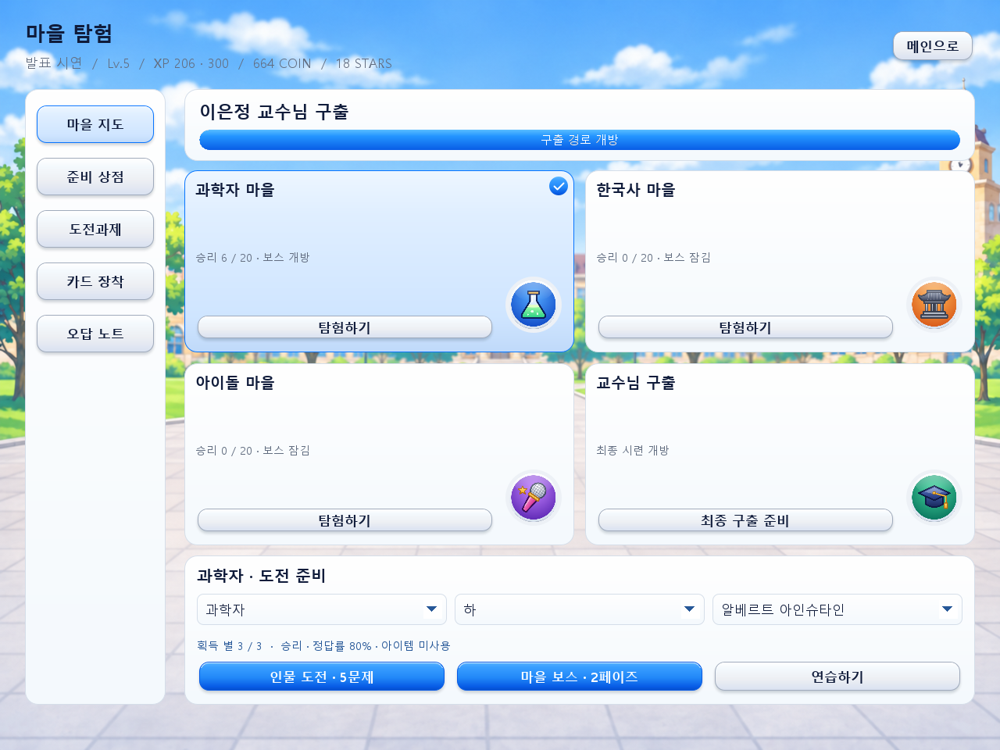

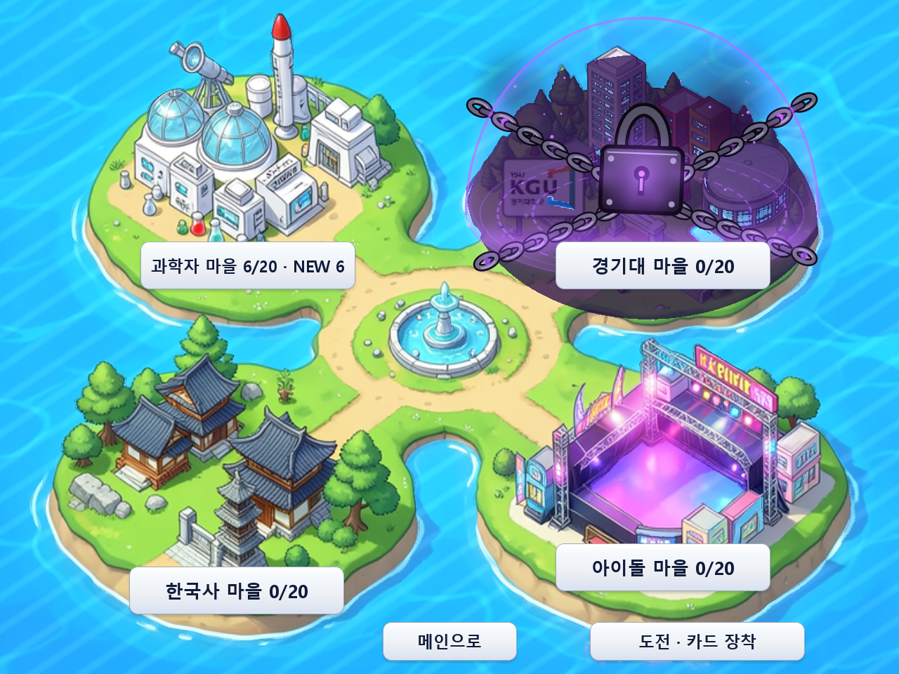

근거: [QuestionBank](../../src/main/java/org/kgu/domain/game/feature/QuestionBank.java), [ProgressStore](../../src/main/java/org/kgu/core/progression/ProgressStore.java).

## 10. 주요 화면 — 연습과 오답 복습

| 화면 영역 | 기능 |
|---|---|
| 상단 | 분야·난이도·모드, 진행률, 이번 판의 콤보 |
| 카드·문제 영역 | 인물 이미지, 질문, 네 개의 보기 |
| 하단 | 인라인 힌트, 선택 후 제출, 피드백 후 다음 문제 |
| 연습 결과 | 정답 수, 보상 없음 안내, 다시 연습·오답 복습 |

연습은 같은 분야·난이도에서 서로 다른 인물 10명을 출제한다. 오답 복습은 저장된 오답에서 최대 10문제를 고른다. 화면 부품은 공유하되 모드별 기록·정산 정책은 기능 로직에서 구분한다.

- **연습:** 카드·XP·코인·숙련도·업적·수집률·해금 진행도 등 보상과 성장 수치가 증가하지 않는다. 오답 노트와 최근 출제 기록만 갱신한다.
- **오답 복습:** 기존 XP·코인·누적 성장 처리를 유지한다. 카드는 지급하지 않는다.
- **강제 위치:** `GameFeature.recordAnswer`가 연습 기록 경로를 선택하고, `saveRewards`는 연습이면 저장 전에 종료한다. `GameSession.getRewards`는 배틀에서만 카드 후보를 반환한다.

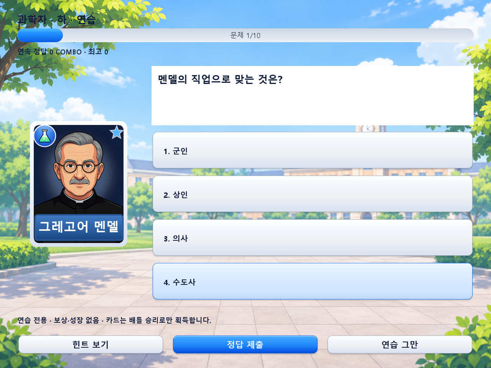

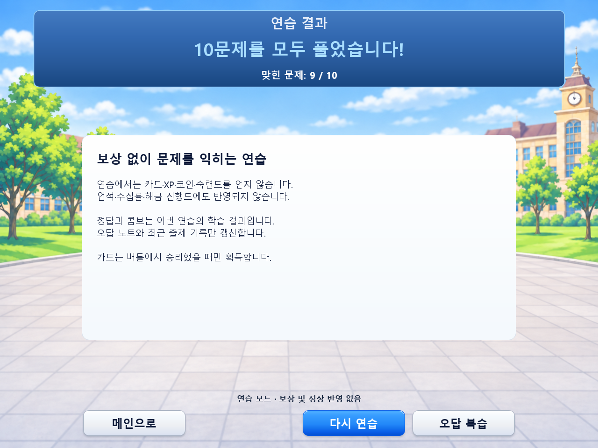

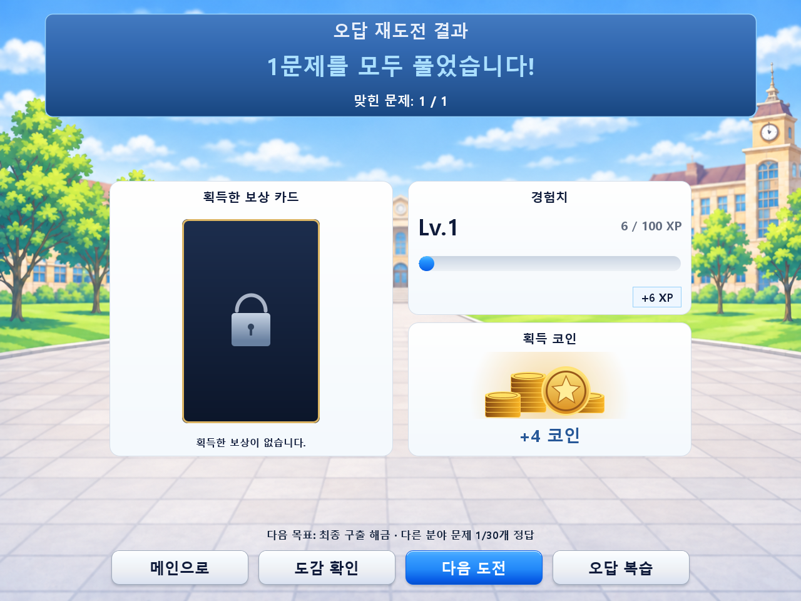

근거: [PracticeLayout](../../src/main/java/org/kgu/domain/game/view/layout/PracticeLayout.java), [GameFeature](../../src/main/java/org/kgu/domain/game/feature/GameFeature.java), [PracticeResultPanel](../../src/main/java/org/kgu/domain/game/view/component/PracticeResultPanel.java).

## 11. 주요 화면 — 일반 배틀과 보스

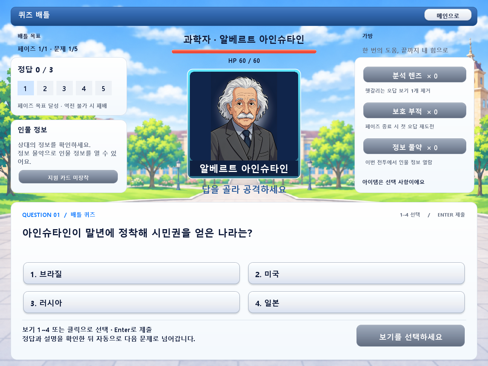

사진은 현재 게임 컴포넌트를 오프스크린으로 새로 촬영한 일반 배틀이다. 페이즈 목표·상대 HP·인물·아이템·답안 제출 영역을 설명한다.

| 도전 | 문제 구성 | 페이즈별 통과 정답 수 |
|---|---|---|
| 일반 인물 | 5문제 | 3개 |
| 마을 보스 | 두 난이도, 총 10문제 | 3개 → 4개 |
| 이은정 교수님 | 하·중·상, 총 15문제 | 3개 → 3개 → 4개 |

마을 보스는 해당 분야의 서로 다른 인물 3명에게 승리하면 열린다. 과학자는 앨런 튜링, 한국사는 김구, 아이돌은 영케이다. 교수님은 다른 세 분야의 서로 다른 문제 30개 정답으로 열린다. 연습 정답은 이 조건에 반영하지 않는다.

`BattleEngine`이 판정과 페이즈 상태를 관리하고, `BattlePanel`과 효과 컴포넌트가 공격·정오답·전환 연출을 재생한다. HP는 해당 페이즈 통과 정답 수 × 20이며 정답마다 20 감소한다. 최종 페이즈를 통과해야 승리한다.

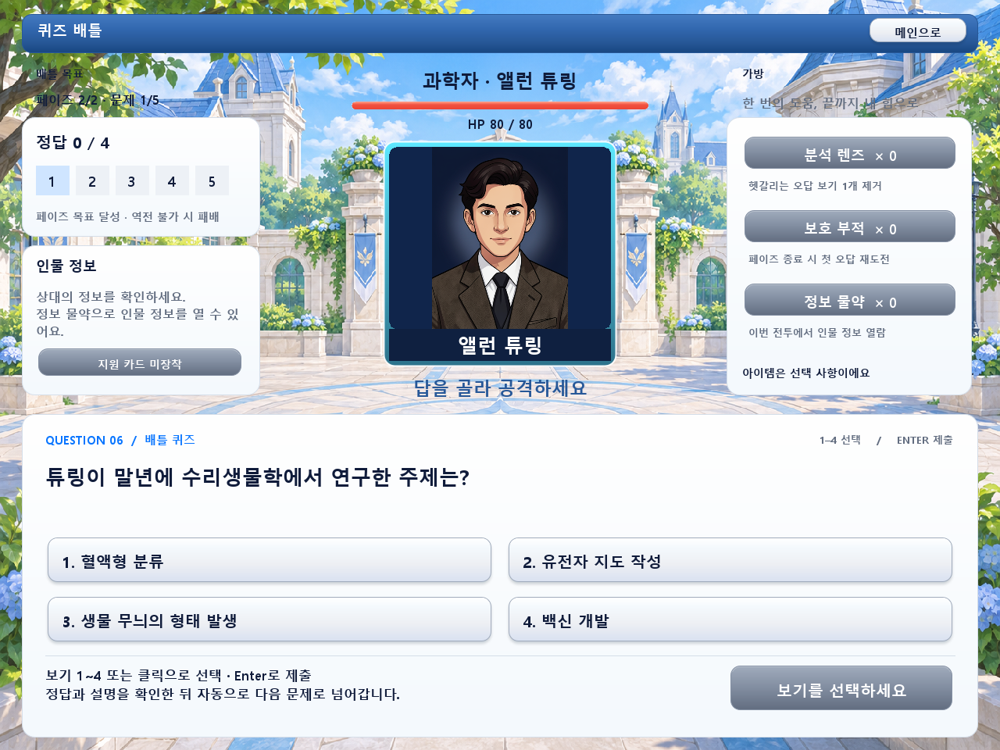

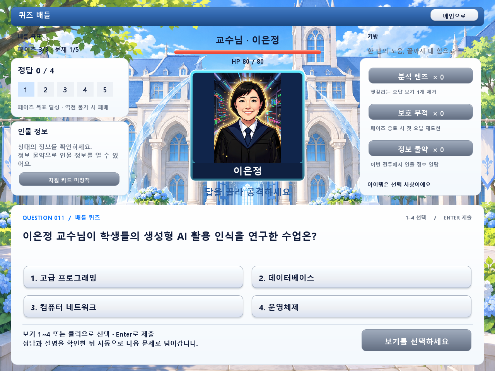

근거: [BattlePhases](../../src/main/java/org/kgu/domain/game/feature/BattlePhases.java), [BattleEngine](../../src/main/java/org/kgu/domain/game/feature/BattleEngine.java).

## 12. 주요 화면 — 카드·지원 능력·결과

카드는 배틀 승리 시 해당 인물·단계로 획득한다. 도감에서 단계를 확인하고, 보유 카드 한 장을 지원 카드로 장착한다. 지원은 정답 피해를 올리는 대신 선택과 보상에 영향을 준다.

| 성향 | 역할 |
|---|---|
| 분석 | 오답 보기 제거·인물 힌트 |
| 돌파 | 콤보 조건을 만족하면 코인 보너스 |
| 수호 | 힌트·실패 위기의 새 보충 문제 |
| 집중 | 전투 XP 보너스 |

결과는 판정이 끝난 세션의 카드·XP·코인과 다음 행동을 표시한다. 최초 승리·난이도에 따라 보상을 가산하고, 같은 세션을 다시 저장해도 정산을 중복 지급하지 않는다.

카드 소유와 단계별 NEW는 저장에서 먼저 확정한다. 획득 연출을 건너뛰어도 소유 기록이 유지된다. NEW는 도감에서 해당 단계 상세를 열 때만 해제한다. 패배 결과는 같은 도전 재시도, 연습 결과는 같은 조건의 다시 연습으로 연결한다.

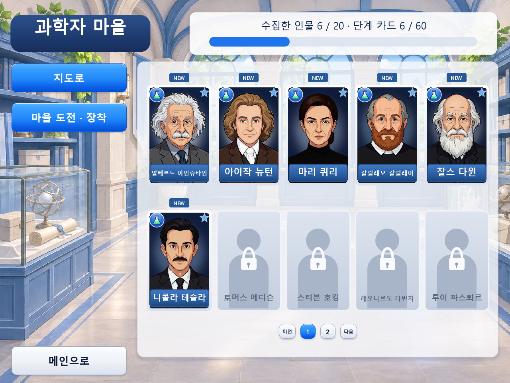

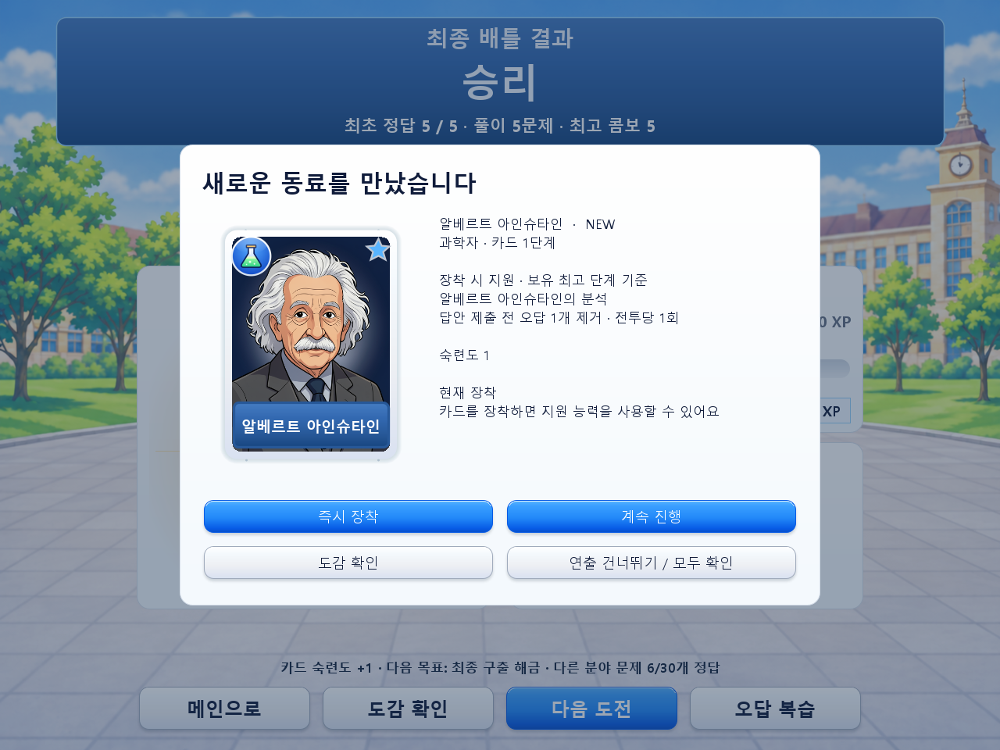

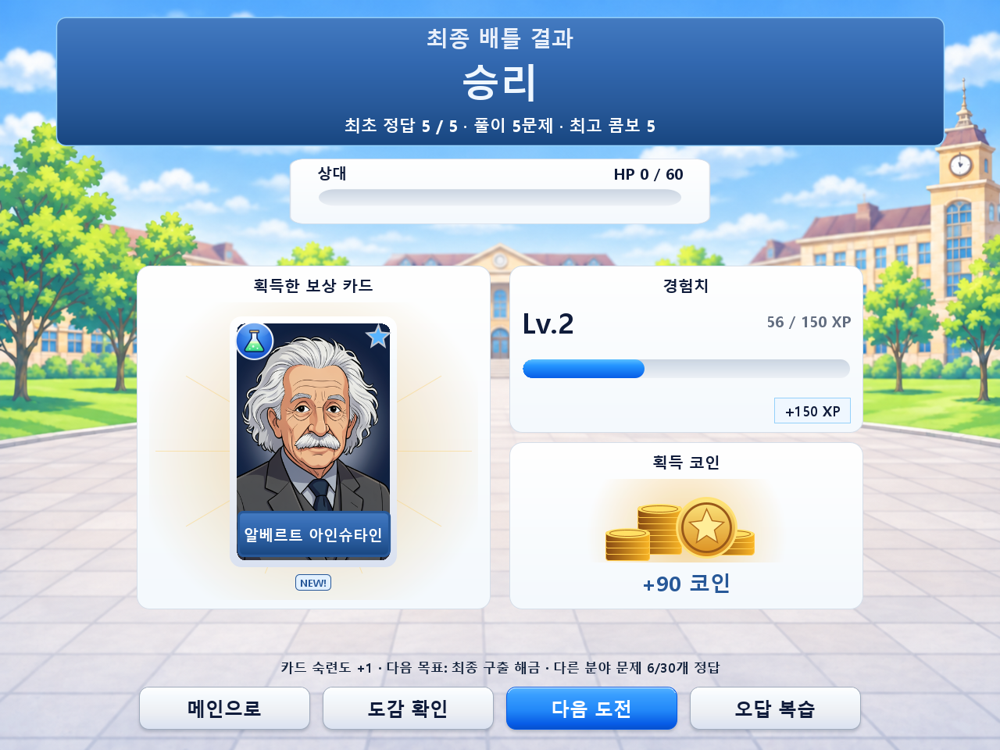

근거: [CardPower](../../src/main/java/org/kgu/core/progression/CardPower.java), [CardRewardEvent](../../src/main/java/org/kgu/domain/collection/event/CardRewardEvent.java), [ResultGUIEvent](../../src/main/java/org/kgu/domain/game/event/ResultGUIEvent.java).

## 13. 스토리·최종 목표와 F1 시연

프롤로그에서 교수님 실종을 제시하고, 마을 도전과 최종 3페이즈를 거쳐 구출 대화·결과·GAME CLEAR로 이어진다. 엔딩은 레벨·수집률·보스 기록·최초 구출 시각과 크레딧을 보여 주며 계속 플레이할 수 있다.

발표에서는 게임 창에서 F1을 열어 장면을 선택한다. 일반 플레이와 같은 기능 객체를 별도 임시 프로필에 연결해 실제 저장을 건드리지 않고 상황을 재현한다.

| 시연 순서 | F1 장면 이름 | 보여 줄 내용 |
|---|---|---|
| 1 | 연습 문제 | 힌트·보기 선택·보상 없는 연습 |
| 2 | 첫 정답 · 공격 연출 | 입력→판정→효과의 연결 |
| 3 | 마을 보스 · 2페이즈 | 목표·HP가 바뀌는 단계별 전투 |
| 4 | 승리 결과 · 카드 획득 | 저장 확정·카드 공개·다음 행동 |
| 5 | 교수님 구출 · 대화 | 최종 전투와 스토리 연결 |
| 6 | 최종 구출 · GAME CLEAR | 엔딩 통계·계속 플레이 |

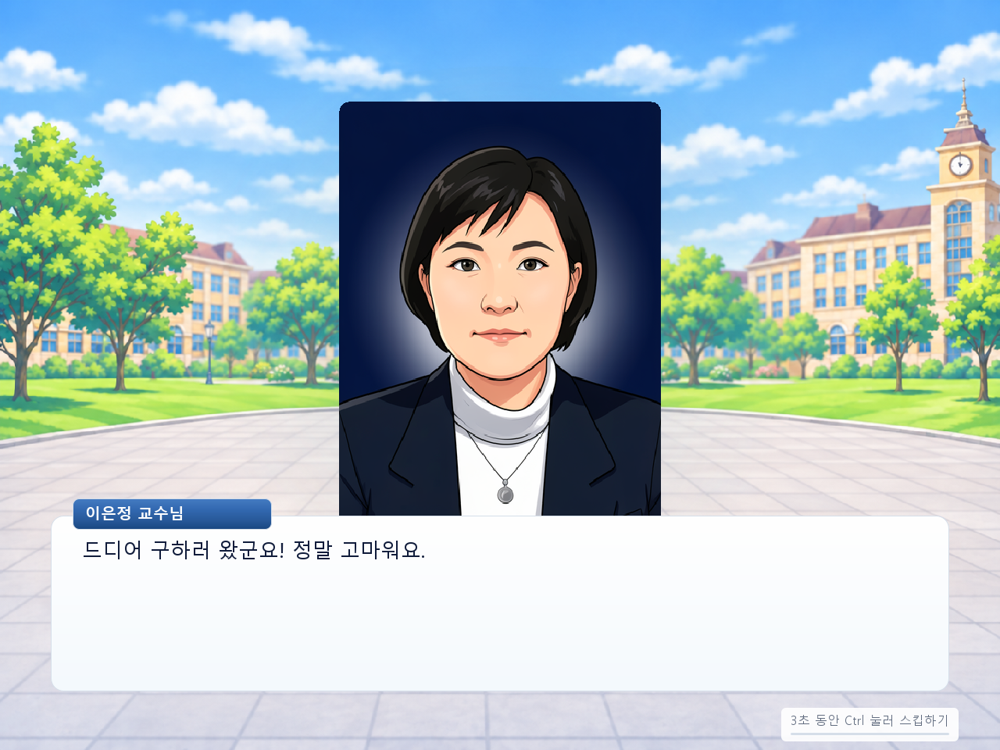

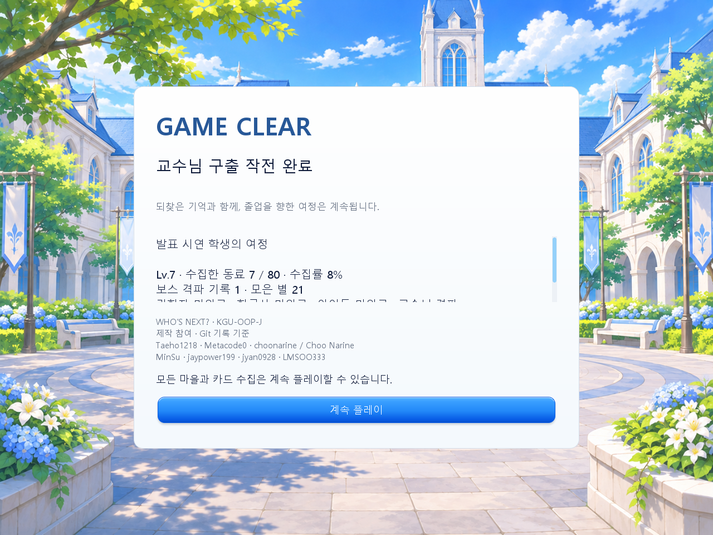

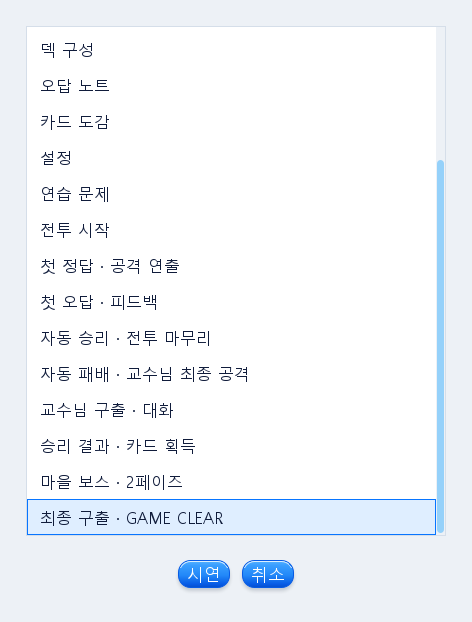

효과의 연속 재생은 실행 시연으로 설명한다. F1 사진은 실제 메뉴 컴포넌트의 내용 영역이다.

근거: [ShowcaseScene](../../src/main/java/org/kgu/domain/showcase/feature/ShowcaseScene.java), [ShowcaseFeature](../../src/main/java/org/kgu/domain/showcase/feature/ShowcaseFeature.java), [EndingFeature](../../src/main/java/org/kgu/domain/story/feature/EndingFeature.java).

## 14. 디자인 시스템과 UI/UX 개편

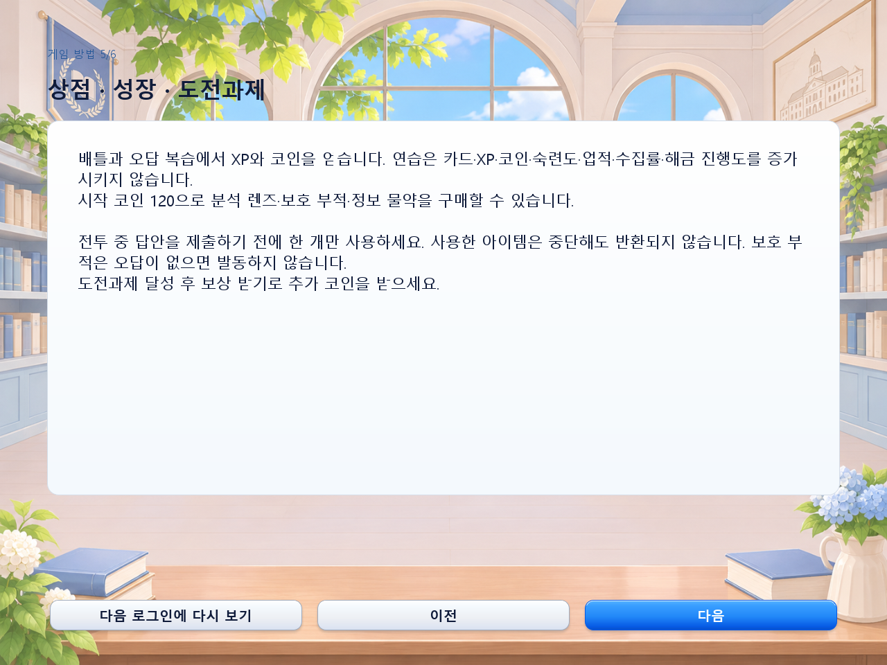

중간 평가 이후 화면을 개편하며 밝은 바탕과 블루 중심의 공통 기준을 세웠다. 버튼·패널·입력·진행 막대의 표시 기준을 디자인 시스템에 모으고 Java2D 페인터와 Swing 컴포넌트로 공유한다.

- 주요 행동과 보조 행동을 구분하고, 답안 선택·제출·정오답 상태를 분명하게 표시한다.
- 기존 배경·인물 이미지는 유지하고, 버튼·아이콘·프레임은 코드로 표현한다.
- 연습·배틀·결과의 반복 부품을 컴포넌트로 나눠 수정 범위를 줄인다.
- 효과의 재생과 타이머 정리는 View가 맡고, 정답·승패·저장 확정은 기능 로직에서 처리한다.

사진은 현재 튜토리얼의 성장 안내 페이지를 새로 촬영한 오프스크린 결과다. 새 배경과 공용 버튼 표현을 함께 확인할 수 있다.

근거: [디자인 시스템](../design-system/index.html#implementation), [공용 UI](../../src/main/java/org/kgu/core/ui/ComponentPainter.java), [TutorialView](../../src/main/java/org/kgu/domain/adventure/view/TutorialView.java).

## 15. 팀 운영 — 변형 Git Flow와 역할 분담

Git Flow를 팀에 맞게 변형해 `develop`을 기본 브랜치와 통합 기준으로 운영했다. 팀원별 MVP를 가져와 View 단위로 분업하고, `feat/new-architecture`의 개선 예시를 공유해 공통 구조를 맞췄다.

```text
develop에서 기능 브랜치 분기
  → 담당 화면·기능 구현
  → Pull Request로 변경 공유
  → 통합 브랜치에서 화면 연결과 데이터 흐름 확인
```

| 협업 단위 | 정리한 내용 |
|---|---|
| 회의 | 화면 연결, 전투 동작, 스토리와 피드백 반영 범위 |
| 역할 분담 | 문제·배틀·결과·도감 등 화면 단위 책임 |
| 구조 공유 | View·Event·Feature 예시와 생성자 주입 방식 |
| 공용 파일 | 화면 전환·공통 UI 수정 시 변경 범위 공유 |
| 통합 | PR로 변경 내용을 확인하고 전체 플레이 흐름 연결 |

현재 최종 작업의 PR 대상은 `feat/final`이다. 초기 개발의 `develop` 운영과 최종 결합 대상을 구분한다. 회의 횟수·실명별 담당은 확인된 팀 자료만 발표에 추가한다.

근거: 팀이 설명한 개발 과정, [기존 분업 가이드](../reference/TEAM_MODULE_GUIDE.md), [당시 회의 반영 기록](../PROFESSOR_BATTLE.md). 두 문서의 옛 패키지 이름은 현재 구조가 아닌 당시 분업 기록으로 사용한다.

## 16. 자체 평가와 배운 점

| 구분 | 평가 |
|---|---|
| 잘한 점 | 팀원별 MVP를 통합하고, 입력·기능·표시 책임을 나눠 UI 개편과 게임 기능 확장을 이어 갔다 |
| 잘한 점 | 카드 수집·지원 능력·보스·구출 대화·엔딩을 하나의 목표 흐름으로 연결했다 |
| 잘한 점 | 연습의 성장 차단, 배틀 전용 카드 지급, 세션 중복 정산 방지를 UI 밖의 규칙으로 구현했다 |
| 개선할 점 | 공용 UI와 화면 전환 기준을 통합 초기에 합의했다면 후반 재작업을 줄일 수 있었다 |
| 개선할 점 | 규칙 변경과 함께 문서·기존 검사 기대값·발표 사진도 갱신하는 절차가 필요했다 |
| 배운 점 | 객체지향 설계는 클래스 수를 늘리는 일보다 상태와 행동의 책임, 협업 시 변경 범위를 정하는 일에 가까웠다 |

팀원별 소감은 본인의 실제 경험으로 마무리한다. 맡은 기능, 가장 큰 설계 변화, 다음 프로젝트에서 바꿀 점을 한 문장씩 준비한다. 확인되지 않은 발언을 대신 작성하지 않는다.

사진: 필수 없음. 마무리는 설계에서 배운 점과 실제 팀원 소감으로 구성한다.
